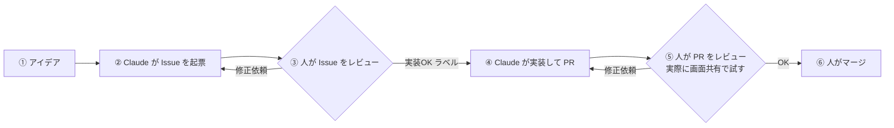

# AI駆動開発フロー（Issue起点）

このリポジトリでは、**人がアイデアと判断を持ち、Claude が書く・作る** という分担で開発します。
すべての作業は GitHub の Issue から始まり、プルリクエスト（PR）で終わります。

## 全体の流れ

## 各ステップ

| # | ステップ | 担当 | やること | ラベル |
|---|---|---|---|---|
| ① | アイデア | 人 | Claude との会話で「こういう場面でこういうものがほしい」と話す。一言でOK | ― |
| ② | Issue 起票 | Claude | テンプレートに沿って Issue を書く。決めきれない点は「確認したいこと」に書き出す | `レビュー待ち` |
| ③ | Issue レビュー | 人 | 使う場面・画面に映すもの・完成の条件が合っているか確認し、Issue にコメントする。Claude はコメントを反映して本文を更新する | `レビュー待ち` |
| ④ | 実装依頼 → 実装 | 人 → Claude | 人が `実装OK` ラベルを付けたら、Claude がブランチを切って実装し、動作確認とスクリーンショットを付けて PR を出す | `実装OK` |
| ⑤ | PR レビュー | 人 | PR のファイルを開いて実際に試す（Zoom / Meet で自分に画面共有してみると確実）。気になる点を PR にコメントする | ― |
| ⑥ | マージ | 人 | 問題なければマージする。Issue は `Closes #番号` で自動的に閉じる | ― |

### 大事な約束

- **`実装OK` が付くまで Claude は実装を始めない。** Issue は「何を作るか」を人と Claude が合意する場所です。
- **マージは必ず人が行う。** Claude は PR を出すところまで。
- **Issue に書かれていないことはやらない。** 実装中に気づいた改善案は、PR の「気づいたこと」に書くか、別の Issue にする。
- Issue と PR のやり取りは日本語で、ファシリテーターが読んで判断しやすい言葉で書く。

## Claude への頼み方

Claude（このリポジトリをつないだセッション）に、普段の言葉で頼めば大丈夫です。

| やりたいこと | 頼み方の例 |
|---|---|
| アイデアを Issue にする | 「チェックインのお題をランダムに出すツールがほしい。Issue にして」 |
| Issue を直す | 「#3 にコメントしたので反映して」 |
| 実装してもらう | 「#3 に実装OKを付けたので作って」 |
| PR を直す | 「#4 の PR にコメントしたので直して」 |
| 今の状況を知る | 「レビュー待ちの Issue と PR を教えて」 |

## ラベル

| ラベル | 意味 |
|---|---|
| `新しいツール` | 新しいツールの提案 |
| `改善` | 既存ツールの改善・不具合修正 |
| `レビュー待ち` | Claude が書いた Issue を人がレビューする段階 |
| `実装OK` | 人がレビューを終え、実装を依頼した状態 |

## これから育てたいこと（案）

- GitHub Pages で公開し、URL を開くだけで使えるようにする
- Issue にコメントで `@claude` と書くと動く仕組み（Claude Code の GitHub Actions）を入れ、会話を開かなくても回せるようにする
- ふりかえりの観点を Issue テンプレートに足し、作ったツールを研修で使った感想を次の改善につなげる
